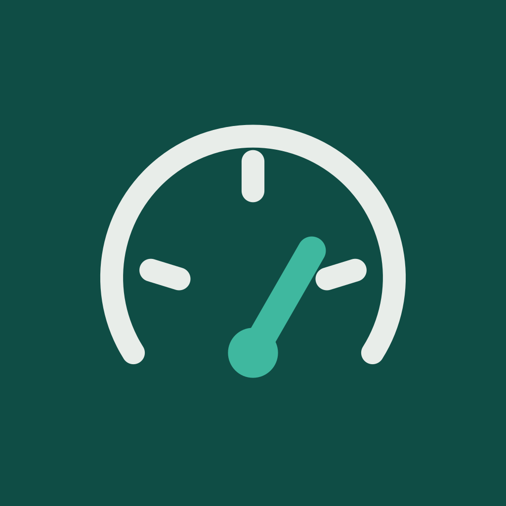
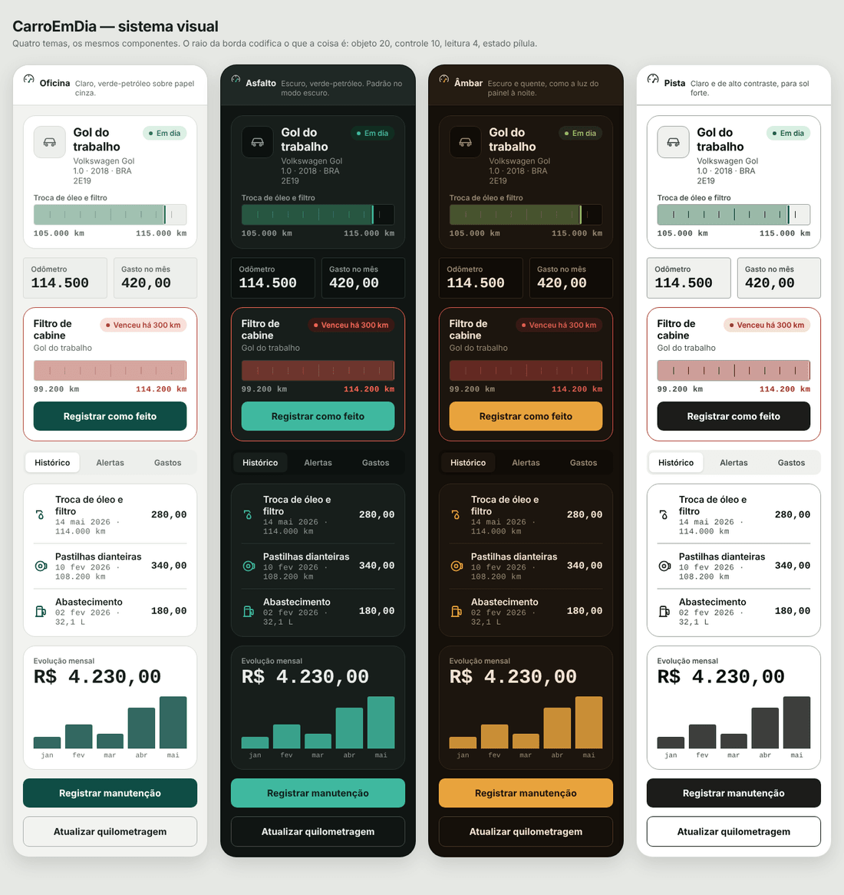

<div align="center">



# CarroEmDia

**O histórico de manutenção do seu carro ou moto, num lugar só.**

Registre o que foi feito, saiba quanto falta para o próximo serviço e veja
para onde o dinheiro está indo.

[](https://github.com/xandoqa/Carro_em_dia/actions/workflows/ci.yml)


</div>

---

## O problema

Muita gente não sabe dizer quando foi a última troca de óleo. As notas ficam na
gaveta, no porta-luvas ou numa conversa de WhatsApp com a oficina, e quando
precisa da informação ninguém acha.

Esquecer sai caro: uma revisão que passa do prazo vira problema no motor, no
freio ou nos pneus, e o conserto custa muito mais do que a manutenção que ficou
para trás. E na hora de vender, quem tem o histórico organizado consegue provar
que cuidou do veículo.

O CarroEmDia guarda esse histórico e avisa **antes** do prazo vencer.

## O que o app faz

- **Garagem** — vários veículos, cada um com foto, placa, odômetro e o estado
  do próximo serviço.
- **Registro de serviços** — tipo, data, quilometragem, valor, oficina,
  observações e foto da nota fiscal.
- **Lembretes calculados** — o app projeta o próximo serviço por quilometragem,
  por data ou pelos dois, e classifica em em dia, chegando ou vencido.
- **Avisos no celular** — notificação local alguns dias antes do prazo, mesmo
  com o app fechado.
- **Relatório de gastos** — total do período, evolução mês a mês, distribuição
  por categoria, maiores gastos, consumo médio em km/L e custo por quilômetro.
- **Consulta à tabela FIPE** — marca e modelo vêm de uma lista oficial no
  cadastro, com o valor de referência do veículo.
- **Quatro temas** — a escolha fica salva e vale na próxima vez que abrir.

## Como ficou

Garagem, painel do veículo e alertas, nos quatro temas:

<div align="center">

</div>

### Protótipo navegável

Abra **[`design/preview/index.html`](design/preview/index.html)** no navegador:
é o app inteiro em HTML, com as 10 telas clicáveis e troca de tema ao vivo.
Nenhuma instalação, nenhum servidor — dois cliques no arquivo e funciona.

Serve para ver o app antes de rodar o Expo, revisar o design sem build e
demonstrar na apresentação caso algo dê errado com o celular. Toque nos
cartões para navegar, ou use <kbd>←</kbd> <kbd>→</kbd> para percorrer as telas.

> É uma maquete fiel, não o app: usa os mesmos tokens de
> `design/tokens/tokens.json`, mas as regras de negócio de verdade vivem em
> `src/domain`.

## Rodando o projeto

**Precisa de:** Node 20 ou mais novo, e o app **Expo Go** no celular (ou um
emulador Android / simulador iOS).

```bash
git clone https://github.com/xandoqa/Carro_em_dia.git
cd Carro_em_dia

npm install

# Alinha as versões das bibliotecas ao SDK do Expo instalado.
# Importante: rode isso na primeira vez.
npx expo install --fix

npm start
```

Leia o QR Code com o Expo Go (Android) ou com a câmera (iOS). Para abrir
direto num emulador: `npm run android` ou `npm run ios`.

> **📘 [Guia completo de execução](docs/como-rodar.md)** — passo a passo desde
> a instalação do Node, roteiro para testar cada requisito da disciplina e
> solução para os erros mais comuns. Se algo não subir, comece por aí.

### Primeiro uso

Em **Ajustes → Dados → Carregar dados de exemplo** o app cria dois veículos com
histórico — já com serviços vencidos, chegando no prazo e em dia. É o caminho
mais rápido para ver tudo funcionando, e o que usamos na apresentação.

### Verificando

```bash
npm test         # 127 testes das regras de negócio, sem emulador
npm run typecheck
npm run lint
npm run verify   # os três acima
```

## Requisitos da disciplina

| Requisito | Onde está |
|-----------|-----------|
| App em React Native | Expo SDK 53 com Expo Router |
| Notificação | [`src/services/notificationService.ts`](src/services/notificationService.ts) |
| Requisição de Web Service | [`src/services/fipeService.ts`](src/services/fipeService.ts) — tabela FIPE pela BrasilAPI |
| Persistência de dados | [`src/data/`](src/data/) — AsyncStorage |
| Mínimo 4 telas interativas | 11 telas |
| GitHub com Git Flow | `main` / `develop` / `feature/*` — ver [`docs/git-flow.md`](docs/git-flow.md) |
| Finalidade além de ver informações | Registra serviços, calcula prazos, agenda avisos, gera relatório |

### As 11 telas

| # | Tela | Arquivo |
|---|------|---------|
| 1 | Garagem | `app/(tabs)/index.tsx` |
| 2 | Alertas | `app/(tabs)/alertas.tsx` |
| 3 | Gastos | `app/(tabs)/gastos.tsx` |
| 4 | Cadastro de veículo | `app/veiculo/novo.tsx` |
| 5 | Painel do veículo | `app/veiculo/[id]/index.tsx` |
| 6 | Editar veículo | `app/veiculo/[id]/editar.tsx` |
| 7 | Histórico | `app/veiculo/historico.tsx` |
| 8 | Registrar manutenção | `app/manutencao/nova.tsx` |
| 9 | Aparência | `app/aparencia.tsx` |
| 10 | Editar manutenção | `app/manutencao/[id].tsx` |
| 11 | Ajustes | `app/ajustes.tsx` |

## Como os lembretes funcionam

Esta é a regra central do app, então vale explicar.

Cada serviço tem um intervalo padrão — óleo a cada 10.000 km ou 12 meses, por
exemplo. Ao registrar um serviço, o app projeta o próximo a partir dali:

```
último serviço: 105.000 km, 10/01/2026
intervalo:      10.000 km
                ↓
próximo:        115.000 km
odômetro hoje:  114.500 km
                ↓
faltam 500 km → janela de atenção é 1.500 km → "chegando"
```

Três decisões que valem registrar:

**A previsão que o usuário informa vale sozinha.** Quem escolheu "avisar em
10.000 km" e deixou os meses em branco não recebe um vencimento por data
herdado do padrão do tipo. Essa regra apareceu escrevendo os testes: a primeira
versão herdava o padrão e criava prazos que ninguém tinha pedido.

**A janela de atenção é proporcional** — 15% do intervalo, com piso de 300 km e
teto de 2.000 km. Um valor fixo erraria dos dois lados: 1.000 km é cedo demais
para uma troca de 3.000 km de moto, e tarde demais para pneus de 40.000 km.

**Lembretes nunca são salvos.** São recalculados a cada leitura, porque o
odômetro muda. Um lembrete gravado ficaria desatualizado em silêncio e o app
passaria a mentir sobre o que está vencido.

## Identidade visual

O protótipo no Figma era um wireframe em preto e branco: definiu a estrutura da
informação, não a aparência. A direção visual veio do mundo do usuário —
oficina, odômetro, etiqueta de revisão no para-brisa — e não de um estilo
genérico de aplicativo.

### A faixa de medida

O elemento assinatura. Uma régua graduada com as duas pontas rotuladas e um
cursor na posição atual:

```
┌───────────────────────────────────────┐
│▓▓▓▓▓▓▓▓▓▓▓▓▓▓▓▓▓▓▓▓▓▓▓▓▓▓▓▓▓▓▓▓▓▓▓│   │
└───────────────────────────────────────┘
 105.000 km                    115.000 km
```

O usuário não quer saber "72% concluído", quer saber que está em 114.500 e que
o limite é 115.000. A régua mostra os três números que respondem à pergunta, e
as marcas de escala dão a noção de distância que uma barra lisa não dá. Quando
o prazo vence, ela preenche sólida na cor de atraso em vez de parar em 100%.

### O raio da borda carrega informação

| Raio | Significa | Onde |
|------|-----------|------|
| 20 | objeto | cartão de veículo, de alerta |
| 10 | controle | botão, campo, aba |
| 4 | leitura | odômetro, faixa de medida |
| 999 | estado | pílula de em dia / chegando / vencido |

### Cor com regra

Verde, âmbar e vermelho pertencem ao **estado do veículo**. Aparecem na pílula
de estado e na faixa de medida, nunca como decoração. É isso que faz a cor
significar alguma coisa: quando o usuário vê vermelho, é porque algo venceu.

### Números são o conteúdo

Toda medida — quilometragem, valores, datas, placa — usa fonte monoespaçada.
Não é estética: em uma lista de dez serviços, a coluna de valores é lida
verticalmente, e com fonte proporcional `180,00` e `1.190,00` não alinham.

Detalhes completos em [`design/identidade/README.md`](design/identidade/README.md).

## O que mudou em relação ao protótipo

| Protótipo | Aqui | Por quê |
|-----------|------|---------|
| Gráfico de pizza nos gastos | Lista com barra empilhada | Numa tela de celular a pizza exige legenda, e a legenda ocupa o mesmo espaço da lista sem permitir ler o valor exato. |
| Barra de progresso simples | Faixa de medida graduada | Mostra as duas pontas e a posição em vez de uma porcentagem abstrata. |
| Rótulos em CAIXA ALTA | Sentence case | Mais rápido de ler, menos ruído. |
| Lista suspensa de tipo de serviço | Grade com as 8 opções visíveis | O tipo é a primeira decisão do formulário. |
| Marca e modelo digitados | Lista da tabela FIPE | Evita "VW" e "Volkswagen" no mesmo app, e traz o valor de referência. |
| Tela de login | Ainda não implementada | Os dados ficam no aparelho e não há contas, então hoje o login seria uma tela sem função. Ver *Próximos passos*. |

## Estrutura do repositório

```
app/              telas (Expo Router — o arquivo define a rota)
src/
  domain/         regras de negócio puras, sem React Native
  data/           persistência (AsyncStorage) e repositórios
  services/       FIPE, notificações, cliente HTTP
  hooks/          estado compartilhado
  theme/          tokens, paletas, provedor de tema
  components/     base/, domain/, charts/
  icons/          conjunto próprio de ícones
  utils/          data, formatação, conversões
  __tests__/      testes das camadas puras
design/
  identidade/     o sistema visual e as decisões por trás dele
  tokens/         tokens.json, gerado a partir de src/theme
  wireframes/     o protótipo original do Figma
  preview/        preview dos quatro temas no navegador
docs/             arquitetura, planejamento, Git Flow, documentação original
assets/images/    ícone, splash, favicon
.github/          CI e modelos de issue e PR
```

## Tecnologias

| O quê | Por quê |
|-------|---------|
| Expo SDK 53 + Expo Router | Rotas por arquivo e build sem configuração nativa |
| TypeScript estrito | Erro que o compilador pega é erro que não chega na apresentação |
| AsyncStorage | Persistência local, sem servidor |
| expo-notifications | Avisos agendados no aparelho |
| react-native-reanimated | A animação da faixa de medida, rodando fora da thread de JS |
| react-native-svg | Os ícones próprios |
| BrasilAPI / FIPE | Marca, modelo e valor de referência |

**Dependências que decidimos não usar:**

- *Biblioteca de gráficos* — centenas de kB para o que cabe em 40 linhas de
  `View`.
- *Biblioteca de estado* (Redux, Zustand) — duas coleções e meia dúzia de ações
  cabem num contexto.
- *Axios* — `fetch` já existe; o que faltava (timeout, retentativa, erro
  tipado) são 90 linhas em `services/http.ts`.
- *3D / `three.js`* — custo alto de bundle e bateria para enfeitar um dado que
  uma barra comunica melhor.

## Próximos passos

Em ordem de utilidade:

1. **Exportar o histórico** — a documentação justifica o app em parte pela
   venda do veículo, e hoje não há como tirar o histórico de dentro dele.
2. **Guardar as fotos no diretório do app** — hoje elas apontam para o cache do
   sistema, que pode ser limpo.
3. **Adiar um lembrete** — um alerta que não some deixa de ser lido.
4. **Login e sincronização** — a camada de dados já é assíncrona, então trocar
   o AsyncStorage por um backend não exige mexer em nenhuma tela.

Cada um está detalhado, com o porquê e o caminho,
em [`docs/melhorias.md`](docs/melhorias.md).

## Documentação

- [**Como rodar o projeto**](docs/como-rodar.md) — instalação, execução e solução de problemas
- [Melhorias: o que foi corrigido e o que fica mapeado](docs/melhorias.md)
- [Arquitetura e decisões técnicas](docs/arquitetura.md)
- [Planejamento de 7 dias](docs/planejamento-7-dias.md)
- [Git Flow do projeto](docs/git-flow.md)
- [Identidade visual](design/identidade/README.md)
- [Documentação original do protótipo](docs/Documentacao_Prototipo_CarroEmDia_UCB.docx)
- [Protótipo do Figma](design/wireframes/prototipo-figma-v1.pdf)

## Equipe

Universidade Católica de Brasília — Engenharia de Software

| Integrante | Matrícula |
|------------|-----------|
| Alexandre Rodrigues Costa | UC23101095 |
| Caio Murilo Silva de Oliveira | UC23100307 |
| Ester Yasmin Santos Silva | UC23102494 |
| Felipe do Nascimento Vitelli Peixoto | UC23200011 |

---

<div align="center">
<sub>Trabalho final — N2</sub>
</div>
