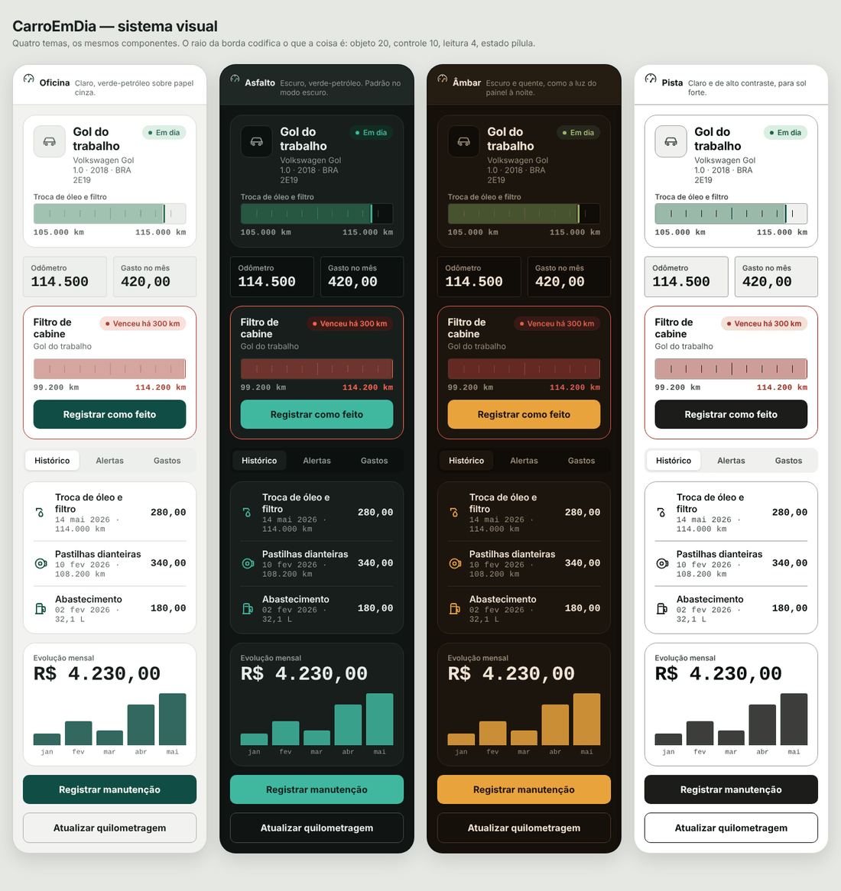

<div align="center">


# CarroEmDia

**O histórico de manutenção do seu carro ou moto, num lugar só.**

Registre o que foi feito, saiba quanto falta para o próximo serviço e veja
para onde o dinheiro está indo.

[](https://github.com/xandoqa/Carro_em_dia/actions/workflows/ci.yml)


<br>

Desenvolvido por **Alexandre Rodrigues Costa**, em dupla com
**Felipe do Nascimento Vitelli Peixoto**
<br>
<sub>Engenharia de Software · Universidade Católica de Brasília</sub>

</div>

---

## O problema

Muita gente não sabe dizer quando foi a última troca de óleo. As notas ficam na
gaveta, no porta-luvas ou numa conversa de WhatsApp com a oficina, e quando
precisa da informação ninguém acha.

Esquecer sai caro: uma revisão que passa do prazo vira problema no motor, no
freio ou nos pneus, e o conserto custa muito mais do que a manutenção que ficou
para trás. E na hora de vender, quem tem o histórico organizado consegue provar
que cuidou do veículo.

O CarroEmDia guarda esse histórico e avisa **antes** do prazo vencer.

## O que o app faz

- **Garagem** — vários veículos, cada um com foto, placa, odômetro e o estado
  do próximo serviço.
- **Registro de serviços** — tipo, data, quilometragem, valor, oficina,
  observações e foto da nota fiscal.
- **Lembretes calculados** — o app projeta o próximo serviço por quilometragem,
  por data ou pelos dois, e classifica em em dia, chegando ou vencido.
- **Avisos no celular** — notificação local alguns dias antes do prazo, mesmo
  com o app fechado.
- **Relatório de gastos** — total do período, evolução mês a mês, distribuição
  por categoria, maiores gastos, consumo médio em km/L e custo por quilômetro.
- **Consulta à tabela FIPE** — marca e modelo vêm de uma lista oficial no
  cadastro, com o valor de referência do veículo.
- **Quatro temas** — a escolha fica salva e vale na próxima vez que abrir.

## Como ficou

Garagem, painel do veículo e alertas, nos quatro temas:

<div align="center">

</div>

### Protótipo navegável

Abra **[`design/preview/index.html`](design/preview/index.html)** no navegador:
são as 11 telas clicáveis, com troca de tema ao vivo. Nenhuma instalação,
nenhum servidor — dois cliques no arquivo e funciona. Toque nos cartões para
navegar, ou use <kbd>←</kbd> <kbd>→</kbd> para percorrer as telas.

> ### ⚠️ O protótipo não é o aplicativo
>
> | | O app | O protótipo |
> |---|---|---|
> | Onde | `app/` e `src/` | `design/preview/` |
> | Tecnologia | **React Native** (React 19, Expo 53) | HTML, CSS e JavaScript puro |
> | Arquivos | 67 em TypeScript | 2 |
> | Regras de negócio | Sim — calcula prazos, salva, notifica, consulta a FIPE | Nenhuma: é uma fotografia navegável |
> | Vale nota | Sim | Não |
>
> O protótipo foi escrito sem framework **de propósito**: ele precisa abrir
> sem `npm install`, sem build e sem servidor — se dependesse de React,
> dependeria justamente do que ele existe para dispensar.
>
> Ele usa os mesmos tokens de `design/tokens/tokens.json`, então desenha as
> telas com fidelidade. Serve para ver o resultado antes de conseguir rodar o
> Expo, revisar o design sem build, e como plano B se o celular falhar na
> apresentação. **Na apresentação, o que se mostra é o app no celular.**

## Rodando o projeto

**Precisa de:** Node 20 ou mais novo, Git, e o app **Expo Go** no celular (ou um
emulador Android / simulador iOS).

```bash
git clone https://github.com/xandoqa/Carro_em_dia.git
cd Carro_em_dia

npm run setup     # instala, alinha as versões e verifica o ambiente
npm start         # inicia o app
```

Leia o QR Code com o Expo Go (Android) ou com a câmera (iOS). Para abrir
direto num emulador: `npm run android` ou `npm run ios`.

> **📘 [Tutorial completo de instalação](docs/como-rodar.md)** — passo a passo
> para **Linux, Windows e macOS**, desde instalar o Node até resolver os erros
> mais comuns. Se algo não subir, comece por aí.

### Se algo der errado

```bash
npm run doctor
```

O diagnóstico verifica ambiente, dependências, versões, arquivos e porta. Para
cada problema ele diz **o que aconteceu, por quê, qual arquivo está envolvido,
como resolver e o comando exato** para executar. Roda sem nenhuma dependência
instalada — justamente para funcionar quando o `npm install` falhou.

### Configuração do ambiente

**Não há nenhuma.** O projeto não usa variáveis de ambiente, arquivo `.env`,
banco de dados nem servidor próprio. Tudo que é configurável está em arquivos
versionados:

| Arquivo | Para que serve |
|---------|----------------|
| `app.json` | Nome, ícone, splash, permissões e plugins do Expo |
| `package.json` | Dependências e comandos |
| `babel.config.js` | Transformações de código (detecta o plugin de worklets sozinho) |
| `tsconfig.json` | Regras do TypeScript |
| `.eslintrc.js` / `.prettierrc` | Padrão de código |

A única chamada externa é a consulta à tabela FIPE pela BrasilAPI, que é pública
e não exige cadastro nem chave.

### Primeiro uso

Em **Ajustes → Dados → Carregar dados de exemplo** o app cria dois veículos com
histórico — já com serviços vencidos, chegando no prazo e em dia. É o caminho
mais rápido para ver tudo funcionando, e o que usamos na apresentação.

### Verificando

```bash
npm run verify   # typecheck + lint + os 127 testes
```

## Requisitos da disciplina

| Requisito | Onde está |
|-----------|-----------|
| App em React Native | Expo SDK 53 com Expo Router |
| Notificação | [`src/services/notificationService.ts`](src/services/notificationService.ts) |
| Requisição de Web Service | [`src/services/fipeService.ts`](src/services/fipeService.ts) — tabela FIPE pela BrasilAPI |
| Persistência de dados | [`src/data/`](src/data/) — AsyncStorage |
| Mínimo 4 telas interativas | 11 telas |
| GitHub com Git Flow | `main` / `develop` / `feature/*` — ver [`docs/git-flow.md`](docs/git-flow.md) |
| Finalidade além de ver informações | Registra serviços, calcula prazos, agenda avisos, gera relatório |

### As 11 telas

| # | Tela | Arquivo |
|---|------|---------|
| 1 | Garagem | `app/(tabs)/index.tsx` |
| 2 | Alertas | `app/(tabs)/alertas.tsx` |
| 3 | Gastos | `app/(tabs)/gastos.tsx` |
| 4 | Cadastro de veículo | `app/veiculo/novo.tsx` |
| 5 | Painel do veículo | `app/veiculo/[id]/index.tsx` |
| 6 | Editar veículo | `app/veiculo/[id]/editar.tsx` |
| 7 | Histórico | `app/veiculo/historico.tsx` |
| 8 | Registrar manutenção | `app/manutencao/nova.tsx` |
| 9 | Aparência | `app/aparencia.tsx` |
| 10 | Editar manutenção | `app/manutencao/[id].tsx` |
| 11 | Ajustes | `app/ajustes.tsx` |

## Como os lembretes funcionam

Esta é a regra central do app, então vale explicar.

Cada serviço tem um intervalo padrão — óleo a cada 10.000 km ou 12 meses, por
exemplo. Ao registrar um serviço, o app projeta o próximo a partir dali:

```
último serviço: 105.000 km, 10/01/2026
intervalo:      10.000 km
                ↓
próximo:        115.000 km
odômetro hoje:  114.500 km
                ↓
faltam 500 km → janela de atenção é 1.500 km → "chegando"
```

Três decisões que valem registrar:

**A previsão que o usuário informa vale sozinha.** Quem escolheu "avisar em
10.000 km" e deixou os meses em branco não recebe um vencimento por data
herdado do padrão do tipo. Essa regra apareceu escrevendo os testes: a primeira
versão herdava o padrão e criava prazos que ninguém tinha pedido.

**A janela de atenção é proporcional** — 15% do intervalo, com piso de 300 km e
teto de 2.000 km. Um valor fixo erraria dos dois lados: 1.000 km é cedo demais
para uma troca de 3.000 km de moto, e tarde demais para pneus de 40.000 km.

**Lembretes nunca são salvos.** São recalculados a cada leitura, porque o
odômetro muda. Um lembrete gravado ficaria desatualizado em silêncio e o app
passaria a mentir sobre o que está vencido.

## Identidade visual

O protótipo no Figma era um wireframe em preto e branco: definiu a estrutura da
informação, não a aparência. A direção visual veio do mundo do usuário —
oficina, odômetro, etiqueta de revisão no para-brisa — e não de um estilo
genérico de aplicativo.

### A faixa de medida

O elemento assinatura. Uma régua graduada com as duas pontas rotuladas e um
cursor na posição atual:

```
┌───────────────────────────────────────┐
│▓▓▓▓▓▓▓▓▓▓▓▓▓▓▓▓▓▓▓▓▓▓▓▓▓▓▓▓▓▓▓▓▓▓▓│   │
└───────────────────────────────────────┘
 105.000 km                    115.000 km
```

O usuário não quer saber "72% concluído", quer saber que está em 114.500 e que
o limite é 115.000. A régua mostra os três números que respondem à pergunta, e
as marcas de escala dão a noção de distância que uma barra lisa não dá. Quando
o prazo vence, ela preenche sólida na cor de atraso em vez de parar em 100%.

### O raio da borda carrega informação

| Raio | Significa | Onde |
|------|-----------|------|
| 20 | objeto | cartão de veículo, de alerta |
| 10 | controle | botão, campo, aba |
| 4 | leitura | odômetro, faixa de medida |
| 999 | estado | pílula de em dia / chegando / vencido |

### Cor com regra

Verde, âmbar e vermelho pertencem ao **estado do veículo**. Aparecem na pílula
de estado e na faixa de medida, nunca como decoração. É isso que faz a cor
significar alguma coisa: quando o usuário vê vermelho, é porque algo venceu.

### Números são o conteúdo

Toda medida — quilometragem, valores, datas, placa — usa fonte monoespaçada.
Não é estética: em uma lista de dez serviços, a coluna de valores é lida
verticalmente, e com fonte proporcional `180,00` e `1.190,00` não alinham.

Detalhes completos em [`design/identidade/README.md`](design/identidade/README.md).

## O que mudou em relação ao protótipo

| Protótipo | Aqui | Por quê |
|-----------|------|---------|
| Gráfico de pizza nos gastos | Lista com barra empilhada | Numa tela de celular a pizza exige legenda, e a legenda ocupa o mesmo espaço da lista sem permitir ler o valor exato. |
| Barra de progresso simples | Faixa de medida graduada | Mostra as duas pontas e a posição em vez de uma porcentagem abstrata. |
| Rótulos em CAIXA ALTA | Sentence case | Mais rápido de ler, menos ruído. |
| Lista suspensa de tipo de serviço | Grade com as 8 opções visíveis | O tipo é a primeira decisão do formulário. |
| Marca e modelo digitados | Lista da tabela FIPE | Evita "VW" e "Volkswagen" no mesmo app, e traz o valor de referência. |
| Tela de login | Ainda não implementada | Os dados ficam no aparelho e não há contas, então hoje o login seria uma tela sem função. Ver *Próximos passos*. |

## Estrutura do repositório

```
app/              telas (Expo Router — o arquivo define a rota)
src/
  domain/         regras de negócio puras, sem React Native
  data/           persistência (AsyncStorage) e repositórios
  services/       FIPE, notificações, cliente HTTP
  hooks/          estado compartilhado
  theme/          tokens, paletas, provedor de tema
  components/     base/, domain/, charts/
  icons/          conjunto próprio de ícones
  utils/          data, formatação, conversões
  __tests__/      testes das camadas puras
design/
  identidade/     o sistema visual e as decisões por trás dele
  tokens/         tokens.json, gerado a partir de src/theme
  wireframes/     o protótipo original do Figma
  preview/        preview dos quatro temas no navegador
docs/             arquitetura, planejamento, Git Flow, documentação original
assets/images/    ícone, splash, favicon
scripts/          diagnóstico e exportação de tokens
.github/          CI e modelos de issue e PR
```

### Principais módulos

| Módulo | Responsabilidade | Depende de |
|--------|------------------|------------|
| `src/domain/models.ts` | Entidades e intervalos padrão por tipo de serviço | nada |
| `src/domain/reminders.ts` | Projeta o próximo serviço e classifica o estado | `models`, `utils/date` |
| `src/domain/expenses.ts` | Agrega gastos, consumo médio e custo por km | `models`, `utils/date` |
| `src/domain/odometer.ts` | Valida leituras de odômetro e correções | `models` |
| `src/domain/notificationSchedule.ts` | Decide **quando** avisar | `models`, `utils/date` |
| `src/data/storage.ts` | Camada fina sobre o AsyncStorage | AsyncStorage |
| `src/data/garageRepository.ts` | CRUD de veículos e manutenções | `storage`, `domain` |
| `src/services/http.ts` | Cliente sobre `fetch`, com timeout e retentativa | nada |
| `src/services/fipeService.ts` | Tabela FIPE com cache de 7 dias | `http`, `storage` |
| `src/services/notificationService.ts` | Conversa com o sistema operacional | `expo-notifications`, `domain` |
| `src/hooks/useGarage.tsx` | Estado compartilhado; deriva os lembretes | `data`, `domain`, `services` |
| `src/theme/` | Tokens, paletas e provedor de tema | nada (exceto `fonts.ts`) |

**A regra que organiza tudo:** `src/domain/` não importa nada do React Native.
É isso que permite rodar as regras de negócio no Node, sem emulador — e é por
isso que os 127 testes rodam em menos de dois segundos.

## Tecnologias

| O quê | Por quê |
|-------|---------|
| Expo SDK 53 + Expo Router | Rotas por arquivo e build sem configuração nativa |
| TypeScript estrito | Erro que o compilador pega é erro que não chega na apresentação |
| AsyncStorage | Persistência local, sem servidor |
| expo-notifications | Avisos agendados no aparelho |
| react-native-reanimated | A animação da faixa de medida, rodando fora da thread de JS |
| react-native-svg | Os ícones próprios |
| BrasilAPI / FIPE | Marca, modelo e valor de referência |

**Dependências que decidimos não usar:**

- *Biblioteca de gráficos* — centenas de kB para o que cabe em 40 linhas de
  `View`.
- *Biblioteca de estado* (Redux, Zustand) — duas coleções e meia dúzia de ações
  cabem num contexto.
- *Axios* — `fetch` já existe; o que faltava (timeout, retentativa, erro
  tipado) são 90 linhas em `services/http.ts`.
- *3D / `three.js`* — custo alto de bundle e bateria para enfeitar um dado que
  uma barra comunica melhor.

## Próximos passos

Em ordem de utilidade:

1. **Exportar o histórico** — a documentação justifica o app em parte pela
   venda do veículo, e hoje não há como tirar o histórico de dentro dele.
2. **Guardar as fotos no diretório do app** — hoje elas apontam para o cache do
   sistema, que pode ser limpo.
3. **Adiar um lembrete** — um alerta que não some deixa de ser lido.
4. **Login e sincronização** — a camada de dados já é assíncrona, então trocar
   o AsyncStorage por um backend não exige mexer em nenhuma tela.

Cada um está detalhado, com o porquê e o caminho,
em [`docs/melhorias.md`](docs/melhorias.md).

## Comandos

| Comando | Finalidade |
|---------|------------|
| `npm run setup` | Instala, alinha versões e verifica. **Primeira vez.** |
| `npm start` | Inicia o app, verificando o ambiente antes |
| `npm run start:limpo` | Inicia limpando o cache do bundler |
| `npm run start:tunnel` | Inicia por túnel, para redes que isolam dispositivos |
| `npm run android` / `ios` / `web` | Abre no emulador, simulador ou navegador |
| `npm run doctor` | Diagnostica ambiente, dependências, versões e porta |
| `npm run doctor:expo` | Diagnóstico oficial do Expo |
| `npm run fix:deps` | Alinha as bibliotecas ao SDK instalado |
| `npm run verify` | typecheck + lint + testes |
| `npm test` | Os 127 testes das regras de negócio |
| `npm run typecheck` | Só a checagem de tipos |
| `npm run lint` / `lint:fix` | Padrão de código |
| `npm run format` | Formata com Prettier |
| `npm run tokens` | Regera `design/tokens/tokens.json` a partir de `src/theme` |

## Problemas conhecidos

| Problema | Causa | Solução |
|----------|-------|---------|
| *"Project is incompatible with this version of Expo Go"* | O `package.json` fixa o SDK 53; o Expo Go da loja acompanha o SDK mais recente | `npm install expo@latest && npx expo install --fix` |
| `ENOSPC: System limit for number of file watchers` (Linux) | Limite do inotify baixo demais para o Metro | `echo fs.inotify.max_user_watches=524288 \| sudo tee -a /etc/sysctl.conf && sudo sysctl -p` |
| QR Code não conecta | Celular e computador em redes diferentes, ou firewall | `npm run start:tunnel` |
| Erro de worklet ao abrir | `babel.config.js` editado à mão | `git checkout babel.config.js && npm run start:limpo` |
| Notificações não chegam | Permissão negada, ou economia de bateria agressiva no Android | Ajustes do sistema → Expo Go → permitir notificações |
| Lista da FIPE vazia | BrasilAPI fora do ar ou celular sem internet | O cadastro continua funcionando com digitação manual |
| `npm run ios` falha | Simulador de iPhone só existe no macOS | Use Android ou um iPhone real com Expo Go |

Todos são detectados pelo `npm run doctor`, que já entrega o comando.

### Limitações conhecidas do app

- **Sem login e sem sincronização.** Os dados ficam no aparelho; trocar de
  celular não leva o histórico junto.
- **As fotos apontam para o cache do sistema.** Se o sistema limpar o cache, a
  imagem da nota fiscal se perde. Ver [`docs/melhorias.md`](docs/melhorias.md),
  item B.
- **Não há exportação do histórico** ainda.
- **Os testes cobrem as regras de negócio, não a interface.** A UI é verificada
  à mão e pelo protótipo em HTML.

## Manutenção e futuras implementações

| Quero mudar... | Mexa em |
|----------------|---------|
| Uma tela | `app/` — o arquivo define a rota |
| Cores, fontes, espaçamento | `src/theme/` — depois rode `npm run tokens` |
| Uma regra de negócio | `src/domain/` — **e escreva o teste junto** |
| Como os dados são salvos | `src/data/` |
| A consulta à FIPE ou as notificações | `src/services/` |
| Um componente reaproveitável | `src/components/` |

**Ao adicionar uma funcionalidade:** se ela tiver regra de negócio, ela vai para
`src/domain/` com teste. Se precisar tocar a plataforma, vai para
`src/services/`. Manter essa separação é o que permite testar sem emulador.

**Ao trocar o armazenamento por um backend:** a interface de
`src/data/garageRepository.ts` já é assíncrona de propósito. Reimplemente as
funções chamando a API e nenhuma tela precisa mudar.

O fluxo de trabalho da dupla e as regras de branch estão em
[`docs/git-flow.md`](docs/git-flow.md).

## Documentação

- [**Como instalar e rodar**](docs/como-rodar.md) — tutorial para Linux, Windows e macOS
- [**Validação**](docs/validacao.md) — o que foi testado, o que falta testar e o roteiro de verificação
- [Melhorias: o que foi corrigido e o que fica mapeado](docs/melhorias.md)
- [Arquitetura e decisões técnicas](docs/arquitetura.md)
- [Planejamento de 7 dias](docs/planejamento-7-dias.md)
- [Git Flow do projeto](docs/git-flow.md)
- [Identidade visual](design/identidade/README.md)
- [Documentação original do protótipo](docs/Documentacao_Prototipo_CarroEmDia_UCB.docx)
- [Protótipo do Figma](design/wireframes/prototipo-figma-v1.pdf)

## Equipe

Universidade Católica de Brasília — Engenharia de Software

### Desenvolvimento

**O desenvolvimento do aplicativo e todas as atualizações foram feitos em
dupla por Alexandre Rodrigues Costa e Felipe do Nascimento Vitelli Peixoto.**

A dupla trabalhou assim, do começo ao fim do projeto:

| Etapa | Responsável |
|-------|-------------|
| Escrita do código | Alexandre |
| Correções e ajustes | Felipe |
| Análise e revisão do código | Alexandre e Felipe, juntos |

Cada funcionalidade passava pelas três etapas antes de ser integrada na
`develop`: Alexandre implementava, Felipe revisava e corrigia, e os dois
analisavam o resultado juntos antes do merge. É essa revisão a quatro olhos
que está por trás das correções registradas em
[`docs/melhorias.md`](docs/melhorias.md) — vários dos defeitos listados ali
apareceram justamente na etapa de análise conjunta.

### Grupo

| Integrante | Matrícula |
|------------|-----------|
| Alexandre Rodrigues Costa | UC23101095 |
| Caio Murilo Silva de Oliveira | UC23100307 |
| Ester Yasmin Santos Silva | UC23102494 |
| Felipe do Nascimento Vitelli Peixoto | UC23200011 |

---

<div align="center">
<sub>Trabalho final — N2</sub>
</div>
